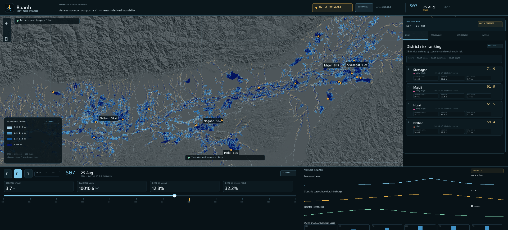

# Baanh — Assam flood-dynamics scenario explorer

**This is not a forecast.** Baanh is a static, explanatory scenario explorer for how a
terrain-derived flood develops across Assam. It reads committed JSON and PNG data from
`public/data/` and renders a synthetic monsoon scenario. It is not an operational warning
service, a record of a real event, or a prediction of what will happen.



*S07 (25 Aug, peak) as the timeline, map, risk rail, and depth-decile strip present it. This
image is an offline render of the M0 layout using the committed flood frame and boundary data,
not a browser capture; run `npm run dev` for the interactive WebGL view.*

## What it is

- **A causal story in one screen.** Rainfall peaks before the main-stem stage; the stage floods
  low HAND terrain; the risk panel shows two labelled ranks — an extent score (area share and
  duration) and a separate severity index (depth share, median depth and duration) — and the
  Validation tab reports the Sentinel-1 extent-shape comparison. The map is the dominant surface;
  the analysis rail floats over it.
- **A terrain screening model, not hydraulics.** HAND = height above nearest drainage. A single
  scenario stage is applied to every mapped channel; cells with lower HAND become wet. There is
  no flow routing, levee failure, sediment, or bathymetry in the model.
- **A static site.** No backend, database, auth, paid key, runtime AI, analytics, or live feed.
  Two optional basemap tile hosts (AWS Terrarium DEM and Esri World Imagery) are visual only; the
  committed hillshade and all local flood frames render when both hosts are blocked.

## Run it

Node 24 is required (`.nvmrc` pins it).

```bash
git clone https://github.com/aditya0si/assam-flood-dynamics.git
cd assam-flood-dynamics
npm ci
npm run dev      # Vite dev server; http://localhost:5173/
npm run build    # tsc --noEmit, then plain vite build at /assam-flood-dynamics/
npm run preview  # serve dist/ at http://localhost:4173/assam-flood-dynamics/
```

The production base path is `/assam-flood-dynamics/` for the GitHub Pages project site
(`https://aditya0si.github.io/assam-flood-dynamics/`); dev stays at `/`. Set `BAANH_BASE`
to override the build/preview base without editing code, for example
`BAANH_BASE=/another-repo/ npm run build`.

One-line form: `npm ci && npm run dev`. For the first Playwright run, install the
browser once with `npx playwright install chromium` (CI does this automatically).

`dev:sandbox` / `build:sandbox` / `preview:sandbox` exist only for the restricted Windows
workspace used during development. They are not used by CI and are not needed by a reviewer.

## Verify it

```bash
npm run verify:m0
```

This is the executable M0 acceptance path. It prints every gate name and runs, in order:

1. `npm run build` — TypeScript and the plain Vite production build.
2. `node scripts/check-data.mjs` — every committed JSON/GeoJSON parses and matches its schema;
   manifest sizes and SHA-256 hashes agree; the A-series invariants (V-A1…V-A10) are re-checked,
   including a real PNG decode for frame dimensions, wet cells, and area. Phase 1b additions
   check the three-way series `class` enum, the ERA5-not-observed rule, the single
   `potentially_exposed_residents` exposure field, and `data_as_of` on every series and panel feed.
3. `node scripts/check-budget.mjs` — ≤400 KB per frame, ≤4 MB animation tier, ≤9 MB total.
4. `node scripts/check-honesty.mjs` — banned fields/claims in `public/data` and `dist/`, with the
   required `NOT A FORECAST` allowed and required present.
5. `node scripts/check-honesty.mjs --self-test` — copies the data, injects `casualties`, `deaths`,
   `displaced`, `affected_persons`, `incident_id`, `agency_id`, `relief_camp`, `unqualified
   forecast`, and `warning issued`, and fails if the real gate does not reject every one.
6. `npm run test:unit` — timeline-store and tile-health unit tests.
7. `playwright test tests/e2e/m0.spec.ts tests/e2e/fallback.spec.ts` — headless Chromium against
   the built preview, asserting through the `window.__baanh` probe:
   load/console cleanliness, 12 steps, playback and keyboard path, S07 readouts, canvas change,
   risk ranking and ESC focus return, layer/opacity controls, provenance, reduced motion,
   the R6 map-dominance/flood-contribution measurement, and the blocked-tile run.

The Playwright config starts the production preview itself. In CI, `npx playwright install
--with-deps chromium` supplies the browser.

### Honesty gate as a real gate

The clean tree passes. The gate is proven to fail by the self-test above; a reviewer can also
point it at an injected copy:

```bash
cp -r public/data /tmp/baanh-data
# add "casualties" to any JSON/text file in /tmp/baanh-data
node scripts/check-honesty.mjs --data /tmp/baanh-data --dist dist
# exits 1 and names the file/line/rule
```

`forecast` is accepted only inside an explicit negation (`NOT A FORECAST`, `not_a_forecast`,
“no forecast is implied”, “not an operational forecast”). A positive phrase such as “operational
forecast” fails. `--data` and `--dist` let the reviewer scan a copy without touching the
committed tree.

## Model limits (read this before citing a number)

- **Synthetic scenario.** The 12-step rainfall and stage curves are a composite scenario, not an
  observed 2022 (or any-year) event. They are labelled `SCENARIO` at the point of use. The separate
  ERA5 archive is `REANALYSIS`, never `OBSERVED`.
- **HAND screening, bathtub depth.** A cell below the burnt channel datum reports the full stage.
  That is **conservative-shallow**: no levee, channel bathymetry, or flow routing is modelled, so
  the depth field is deliberately biased shallow rather than pretending to be a hydrodynamic
  solution.
- **No operational claims.** No casualty, displacement, incident, agency, relief-camp, ETA, or
  “warning issued” field exists in the data or UI. Risk is scenario-conditional terrain exposure,
  not expected loss.
- **Population exposure is an estimate.** WorldPop 2020 (1 km) is crossed with the synthetic peak
  mask and district polygons. The only resident field is `potentially_exposed_residents`, class
  `DERIVED`; it is not an impact assessment and does not estimate who was affected, who moved, or
  loss of life.
- **Surface-water only.** The model does not represent rainfall-runoff, sediment, embankment
  breaches, or backwater hydraulics beyond the committed stage allowance.
- **Basemap tiles are optional.** When both remote hosts fail, the app reports `offline`, keeps
  the committed relief, and all local overlays and playback continue to work.

## Data provenance summary

The committed dataset is `public/data/`, versioned `2026.10.0`, scenario
`assam-monsoon-composite-v1`. The app loads only committed files; it does not fetch a live feed or
invent values.

| Surface | Class | Source → processing → committed file |
|---|---|---|
| Terrain / hillshade | source | AWS Terrarium DEM → `fetch-terrain`, `build-dem` → `data/basemap/assam-hillshade.webp` |
| Districts / state | source | geoBoundaries gbOpen ADM2/ADM1 → `build-admin` → `data/admin/*.geojson` |
| Rivers | source | OSM Overpass (Natural Earth fallback) → `build-rivers` → `data/hydro/assam-rivers.geojson` |
| Flood extent / depth | scenario | DEM + mapped channels + synthetic stage → HAND/inundation → `data/flood/frames/step-00…11.png`, `flood-summary.json`, `frame-index.json` |
| Risk zones / ranking | derived | HAND × scenario duration/depth → `build-risk` → `data/risk/risk-zones.geojson`, `district-risk.json` (extent score + separate severity index) |
| Rainfall / stage series | scenario | Scenario parameters + DEM/HAND profiles → `build-series` → `data/series/monsoon-series.json` |
| ERA5 rainfall | reanalysis | ERA5 via Open-Meteo archive → `build-rainfall` → `data/series/rainfall.json` (JJAS 06-01..09-30 only, 2015-2025; 2022 JJAS and 2015-2025 JJAS mean per district; off-season days omitted for rate-limit reasons, not unavailability) |
| Current-window model guidance | scenario | Open-Meteo current-window endpoint → `build-rainfall` → `data/series/rainfall-forecast.json` (stored separately; not observed) |
| Population exposure | derived | WorldPop 2020 1 km → `build-exposure` → `data/exposure/district-exposure.json` (masked zonal `potentially_exposed_residents`, `district_population`, AOI-clipped `population_within_aoi`) |
| Sentinel-1 validation | derived | Two Jun–Jul 2022 Sentinel-1 GRD VV acquisitions → `build-validation` → `data/validation/scorecard.json` (extent-shape IoU, not an event hindcast) |

`data/provenance.json` carries the full source → stage → file record, licences, and assumptions
for every dataset. `data/validation-report.json` records V01–V22 and V-A1…V-A10; the committed
report is `pass`. The Sentinel-1 scorecard and its two caveats are gated by `check-data`.

## Accessibility baseline

- Two skip links: **Skip to scenario timeline** and **Skip to analysis panels**.
- Timeline is a focusable region: `Space` play/pause, `←`/`→` one step, `Home`/`End` first/last.
- Risk rows are native buttons: `Enter` selects the district; `Escape` returns focus to the
  active panel tab.
- Visible `:focus-visible` rings on every interactive control; `aria-label`s on transport, speed,
  layer visibility/opacity, and timeline controls.
- `prefers-reduced-motion: reduce` removes the flood crossfade and lengthens the step dwell; it
  never freezes playback.

## Repository layout

```text
src/                 React app, map, timeline, charts, panels, state, data contracts
public/data/         committed dataset (do not edit by hand)
scripts/             check-data / check-budget / check-honesty + sandbox-only runners
tests/e2e/           Playwright M0 and blocked-tile specs
docs/                architecture, pipeline, milestone and review records
pipeline/            Python data pipeline (not needed to run the app)
```

## Deployment

`.github/workflows/pages.yml` builds with plain `npm ci && npm run build` and deploys `dist/` to
GitHub Pages. `.github/workflows/ci.yml` installs Chromium and runs `npm run verify:m0`. The
sandbox scripts are deliberately excluded from both workflows. The Vite base path is
`/assam-flood-dynamics/` for build and preview (the project Pages URL) and `/` for dev;
`BAANH_BASE` overrides it for a differently named repository.

## Licence and attribution

Boundaries: geoBoundaries (ODbL 1.0 / CC BY 2.5 IN as recorded in provenance). Rivers: ©
OpenStreetMap contributors (ODbL 1.0). Elevation: AWS Terrarium / Mapzen. Imagery, when enabled:
Esri, Maxar, Earthstar Geographics (basemap only, not an event observation). Full terms and
source links are in `public/data/provenance.json` and `data/manifest.json`.
